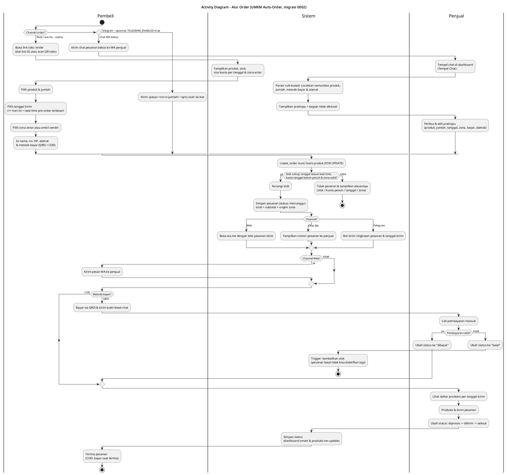
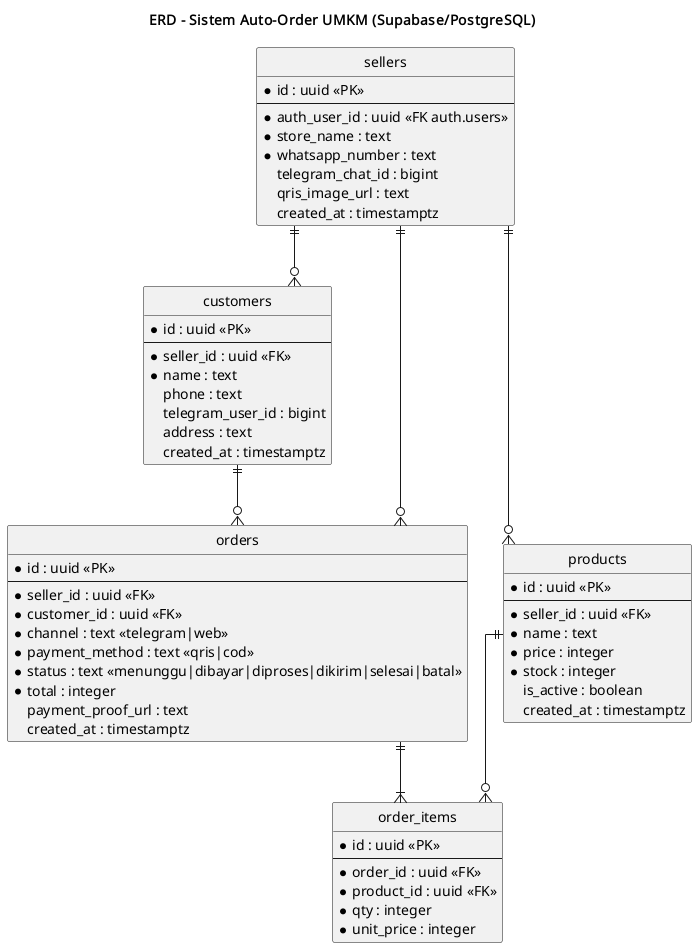

# UMKM Auto-Order

Sistem auto-order untuk UMKM: pembeli pesan lewat **bot Telegram** atau **form web → WhatsApp (wa.me)**, semua pesanan tercatat di **Supabase**, dan penjual memantau pesanan, stok, serta omzet di **dashboard Next.js**. Gratis, tanpa WhatsApp Business API berbayar.

## Masalah
- Data BPS 2024: **94,76%** usaha yang jualan online memakai aplikasi chat (WA dll), hanya **1,36%** lewat website, dan **74,79%** masih bayar tunai.
- Order lewat chat dicatat manual → pesanan kelewat, stok tidak sinkron, omzet tidak kelihatan.
- WhatsApp Business API resmi berbayar & perlu verifikasi Meta → mahal untuk UMKM kecil.

## Fitur
**Pembeli**
- Halaman `/order`: daftar produk + stok, keranjang, pilih QRIS/COD → pesanan disimpan → WhatsApp terbuka dengan teks pesanan terisi.
- Bot Telegram: `/start`, `/produk`, `/pesan 1x2,3x1 cod`.
- QRIS statis (gambar dari env) + kirim bukti bayar ke penjual.

**Penjual** (`/dashboard`, login email Supabase Auth)
- Daftar pesanan + ubah status (menunggu → dibayar → diproses → dikirim → selesai / batal).
- CRUD produk & stok.
- Grafik omzet 14 hari.

**Keamanan**
- Validasi input di server (Zod), stok dicek atomik di fungsi database `create_order`.
- Row Level Security aktif di semua tabel; insert pesanan hanya lewat server (service role), service key tidak pernah dikirim ke browser.
- Webhook Telegram diverifikasi lewat header `X-Telegram-Bot-Api-Secret-Token`.

## Tech Stack
Next.js 16 (App Router) · TypeScript · Tailwind CSS · Supabase (Postgres, Auth, RLS) · Zod · Recharts · Node.js 24

## Screenshot
> _Belum ada, akan ditambahkan._
<!--  -->
<!--  -->

## Diagram
### Activity Diagram — Alur Order


Sumber: [`diagrams/activity-order.puml`](diagrams/activity-order.puml)

### ERD


Sumber: [`diagrams/erd.puml`](diagrams/erd.puml)

## Setup
1. Pakai Node.js 24 (`nvm use`), lalu `npm install`.
2. Buat project di [Supabase](https://supabase.com), lalu jalankan `supabase/migrations/0001_init.sql` di SQL Editor.
3. Buat user penjual di **Authentication > Users**, salin id-nya ke `supabase/seed.sql` (data contoh/sample), lalu jalankan seed.
4. `cp .env.example .env.local` dan isi nilainya. `SUPABASE_SERVICE_ROLE_KEY` **rahasia**, jangan diberi prefix `NEXT_PUBLIC_`.
5. `npm run dev` → buka http://localhost:3000/order dan http://localhost:3000/dashboard.

### Bot Telegram
1. Buat bot lewat [@BotFather](https://t.me/BotFather), isi `TELEGRAM_BOT_TOKEN`.
2. Setelah app online (HTTPS), daftarkan webhook:
   ```bash
   curl "https://api.telegram.org/bot<TOKEN>/setWebhook" \
     -d "url=https://<domain>/api/telegram" \
     -d "secret_token=<TELEGRAM_WEBHOOK_SECRET>"
   ```

## Batasan MVP
- Satu toko (`STORE_SELLER_ID`).
- Stok dicek saat order tapi tidak dikurangi otomatis; penjual memperbarui stok di dashboard (sesuai activity diagram).
- Bukti bayar QRIS dikirim lewat chat; upload ke Supabase Storage belum ada.

## Lisensi
[MIT](LICENSE)
